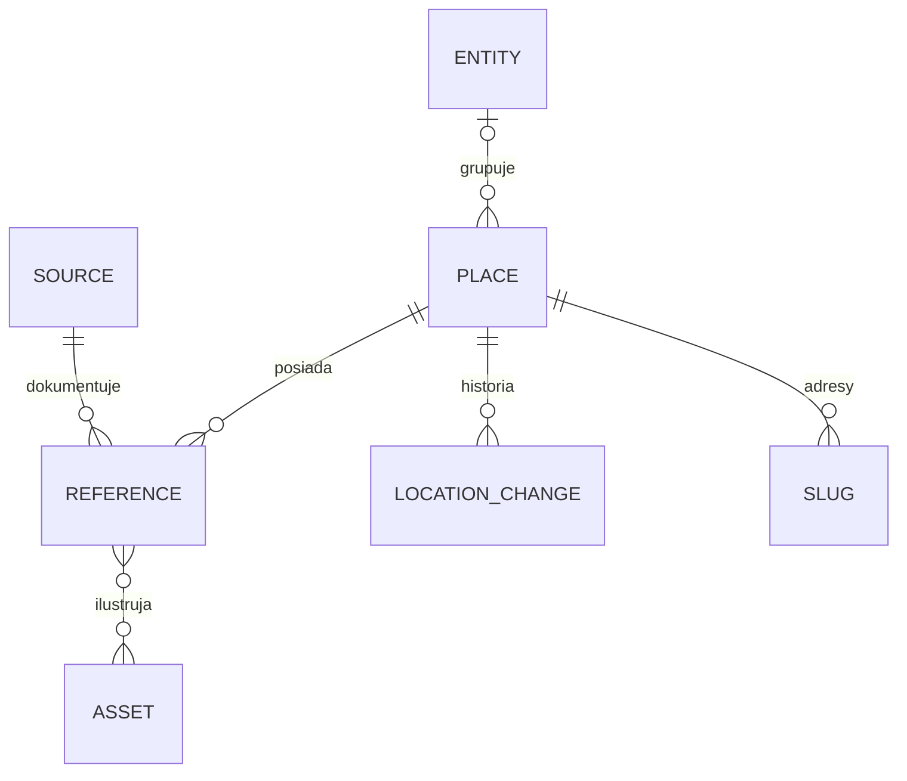

# MVP.1 — propozycja modelu danych

Data: 4 listopada 2026. Status: **propozycja do przeglądu; bez tworzenia bazy, Storage, indeksów i reguł dostępu**.

Architektura: Angular SSG + Firebase Hosting + Functions 2nd gen. Opisy i referencje trafiają do statycznego HTML; mapa i bieżące współrzędne działają w przeglądarce. Model realizuje [plan produktu](README.md) i [plan techniczny](technika.md).

## 1. Baza i region — propozycja

Projekt: `historyczny-rybnik`. Docelowy identyfikator bazy: `(default)`. **Proponowana edycja: Enterprise, tryb Native, operacje Core.** Nie wybieramy kompatybilności MongoDB. Logika aplikacji korzysta na początek z dokumentów, prostych zapytań i transakcji; nie zależy od funkcji wyszukiwania w wersji Preview.

| Wariant | Zalety dla projektu | Konsekwencje |
| --- | --- | --- |
| Enterprise Native — propozycja | Możliwość późniejszego wykorzystania rozbudowanych zapytań; podstawowy model dokumentowy i operacje Core | Własny plan indeksów, rozliczanie operacji według jednostek danych; koszt zależy m.in. od rozmiarów dokumentów i indeksów |
| Standard Native — alternatywa | Wystarcza dla zakresu MVP; automatyczne indeksy pojedynczych pól i prostsze rozliczanie dokumentów | Mniej możliwości zapytań; wyszukiwanie nazw pozostaje po stronie aplikacji |

Enterprise nie jest wymaganiem funkcjonalnym ani obietnicą niższego kosztu. Dla około 200 miejsc oba warianty wystarczą. Wybór Standard nie wymaga zmiany opisanych relacji, ale zmienia konfigurację indeksów i kalkulację kosztów. Wybór edycji zatwierdzamy przed utworzeniem bazy.

**Proponowany region: `europe-central2` (Warszawa)** dla Firestore, Functions 2nd gen i regionalnego bucketa Storage. Wszystkie trzy usługi oferują ten region. Wspólna lokalizacja ogranicza komunikację między regionami; nie oznacza, że Hosting/CDN i Authentication stają się usługami ograniczonymi do Warszawy. Alternatywa kosztowa do porównania przed wdrożeniem: wspólne `europe-west1` (Belgia). Functions w Warszawie są w tabeli Tier 2, w Belgii Tier 1; nie wyprowadzamy z tego ceny całej aplikacji.

Weryfikacja środowiska: Firebase MCP potwierdził projekt `historyczny-rybnik` i brak włączonych rozliczeń. Odczyt listy baz przez CLI zwrócił HTTP 403 z informacją o niewłączonym Cloud Firestore API. Nie jest to udana inwentaryzacja instancji. Dokument określa proponowaną nową bazę, a nie wykrytą edycję istniejącej instancji. Przed provisioningiem ponawiamy odczyt i potwierdzamy lokalizację; w ramach tego planu nie włączamy API ani rozliczeń.

Źródła: [edycje Firestore](https://firebase.google.com/docs/firestore/editions), [różnice edycji Native](https://firebase.google.com/docs/firestore/compare-editions-for-native-mode), [regiony Firestore](https://firebase.google.com/docs/firestore/locations), [regiony Functions](https://firebase.google.com/docs/functions/locations), [lokalizacje Storage](https://docs.cloud.google.com/storage/docs/locations).

## 2. Co jest jednym miejscem

**Miejsce (`place`) to jedna historyczna siedziba lub lokalizacja opisywanego obiektu.** Ma własny trwały ID i kartę `/miejsca/:slug`, nawet jeśli współrzędne nie są znane.

- Instytucja działająca pod dwoma adresami ma dwa miejsca, połączone przez `entityId`.
- Dwie różne instytucje w jednym budynku mają osobne miejsca i mogą dzielić współrzędne.
- Zmiana nazwy bez przeprowadzki zwykle oznacza alias tego samego miejsca. Nie łączymy rekordów automatycznie, gdy tożsamość jest niepewna.
- Korekta błędnie wskazanej pozycji nie tworzy nowego miejsca ani nowej historycznej siedziby; tworzy wpis historii edycji.
- Gdy wzmianka nie pozwala rozstrzygnąć siedziby, zachowujemy `identificationStatus: uncertain` i wyjaśnienie. Nie kopiujemy jej jako pewnego dowodu do kilku lokalizacji.

ID dokumentów są losowe, niezależne od nazwy, adresu, sluga i ID z MVP.0. Powiązania zapisujemy jako ID, a istnienie dokumentów sprawdza backend/importer. Firestore nie zastępuje tych kontroli kluczami obcymi.

## 3. Kolekcje i relacje

| Ścieżka | Jeden dokument oznacza | Zakres |
| --- | --- | --- |
| `places/{placeId}` | Kartę jednej siedziby i jej aktualną pozycję | MVP.1 |
| `entities/{entityId}` | Wspólną tożsamość instytucji/firmy dla kilku siedzib | MVP.1, opcjonalne powiązanie |
| `sources/{sourceId}` | Konkretną publikację, numer czasopisma, mapę lub dokument | MVP.1 |
| `places/{placeId}/references/{referenceId}` | Konkretną wzmiankę łączącą miejsce ze źródłem | MVP.1 |
| `assets/{assetId}` | Metadane jednego pliku i jego wariantów | MVP.1 |
| `places/{placeId}/locationChanges/{changeId}` | Jedną opublikowaną korektę pozycji | MVP.1, odczyt administracyjny |
| `slugs/{slug}` | Rezerwację adresu i wskazanie miejsca | MVP.1 |
| `releases/{releaseId}` | Manifest wersji publikacji SSG i wynik deploymentu | MVP.1, dane techniczne |
| `runtime/publication` | Wskazanie aktywnego wydania katalogu | MVP.1, dane techniczne |
| `users/{uid}` | Minimalne prywatne dane aplikacyjne konta | Dopiero gdy potrzebne; Auth wystarcza do logowania |
| `submissions/{submissionId}` | Prywatne zgłoszenie komentarza, źródła lub zdjęcia | Przyszłość |
| `places/{placeId}/comments/{commentId}` | Publiczny, zatwierdzony komentarz | Przyszłość |



Referencje, pliki i historia nie rosną w jednej tablicy dokumentu miejsca. API karty zwraca listę referencji, ale fizycznie przechowujemy je osobno. Krótkie aliasy i adresy mogą być tablicami z limitami. Dla Native dokument ma limit 1 MiB; nie przechowujemy w nim obrazów ani całych publikacji. [Model danych Firestore](https://firebase.google.com/docs/firestore/data-model).

## 4. Dokument miejsca

Poniższe przykłady są fikcyjne i służą wyłącznie omówieniu schematu. ISO daty techniczne w przykładach odpowiadają typowi Firestore `Timestamp`; API serializuje je do ISO 8601. `point` jest Firestore `GeoPoint`, w API obiektem `{lat, lng}`.

```json
{
  "schemaVersion": 1,
  "entityId": "entity_example",
  "slug": "przykladowa-szkola-przy-ulicy-a",
  "name": "Przykładowa szkoła przy ulicy A",
  "aliases": ["Dawna nazwa szkoły"],
  "category": "education",
  "summary": "Krótki tekst do listy i metadanych.",
  "descriptionMarkdown": "Opis opracowany na podstawie referencji.",
  "addresses": [
    {"kind": "historical", "text": "Dawna ulica A 12", "district": null},
    {"kind": "current", "text": "Ulica B 12", "district": null}
  ],
  "identificationStatus": "certain",
  "identificationNote": null,
  "location": {
    "point": null,
    "precision": "unknown",
    "rationale": null,
    "referenceIds": [],
    "updatedAt": null
  },
  "locationVersion": 0,
  "editorialStatus": "draft",
  "contentVersion": 1,
  "createdAt": "2026-11-04T12:00:00Z",
  "contentUpdatedAt": "2026-11-04T12:00:00Z",
  "legacyIds": []
}
```

| Pole / grupa | Reguła |
| --- | --- |
| `entityId` | Opcjonalne; `null` dla samodzielnego obiektu lub nieustalonej tożsamości |
| `slug` | Unikatowy, małe litery ASCII i łączniki, maks. 120 znaków; aktualny adres redakcyjny |
| `name`, `summary` | Wymagane; proponowane limity 200 i 400 znaków |
| `descriptionMarkdown` | Treść redakcyjna, maks. 50 tys. znaków; renderowanie z usuwaniem niebezpiecznego HTML |
| `aliases`, `addresses` | Do 30 aliasów i 20 adresów na kartę; każdy tekst adresu do 300 znaków; nieznany adres nie jest obowiązkowy |
| `category` | Jedna z `industry`, `education`, `religion`, `commerce`, `public`, `culture`, `other`; nazwy polskie tylko w UI |
| `identificationStatus` | `certain` lub `uncertain`; niepewność wymaga wyjaśnienia |
| `editorialStatus` | `draft`, `ready`, `withdrawn`; sam status `ready` nie publikuje karty |
| `contentVersion` | Zwiększana przy zmianach redakcyjnych, niezależnie od lokalizacji |
| `legacyIds` | Ślad kontrolowanego importu, np. `{system: "mvp0", id: "..."}`; bez przejmowania ID źródłowych jako nowych ID |

Brak daty działalności w miejscu nie jest uzupełniany zakresem od pierwszej do ostatniej wzmianki. W MVP.1 daty historyczne przechowujemy przy referencjach. Osobny model udowodnionych okresów działalności można dodać później.

### Lokalizacja

`precision`: `unknown`, `street`, `area`, `building`. To opis dokładności, a nie redakcyjny certyfikat prawdziwości. Interfejs pokazuje odpowiednio „Lokalizacja nieustalona”, „Przybliżona — ulica”, „Przybliżona — obszar” lub „Wskazany budynek”.

- `unknown` oznacza `point: null`, bez znacznika. Inne wartości wymagają prawidłowego GeoPoint i uzasadnienia do 1000 znaków.
- Domyślna nowa lokalizacja jest przybliżona; użytkownik wybiera ulicę lub obszar. Wskazanie budynku nadal nie jest potwierdzeniem przez redaktora.
- `referenceIds` mogą być puste, gdy autor uzasadnia wskazanie własną wiedzą; podane ID muszą należeć do publicznych referencji tego miejsca. Nie tworzymy fikcyjnej referencji dla każdego kliknięcia.
- Backend sprawdza zakres WGS84 oraz położenie względem wersjonowanej granicy administracyjnej Rybnika. Punkt poza granicą odrzuca z komunikatem; przypadki sporne na granicy wymagają decyzji właściciela/importu administracyjnego.
- Każdy zalogowany może zmienić pozycję i dokładność. Usuwanie lokalizacji (`unknown`) proponujemy na początek pozostawić administratorowi; cofnięcie jest kolejnym wpisem historii. To szczegół do zatwierdzenia.

## 5. Instytucja, źródło i referencja

`entities/{id}`: `schemaVersion`, `name`, `aliases`, `description` (opcjonalny krótki kontekst), `createdAt`, `updatedAt`. Grupuje siedziby bez własnej publicznej trasy w MVP.1. Opisy karty nie wymagają wykonania złączenia w przeglądarce.

`sources/{id}`: `schemaVersion`, `type` (`book`, `periodical`, `directory`, `map`, `archive`, `website`, `other`), `title`, `authors` (lista), `publisher`, `issue` (opcjonalne), `publicationDate` (typ z sekcji 6 lub `null`), `originalUrl`, `archiveIdentifier`, `accessedAt` (Timestamp lub `null`), `createdAt`, `updatedAt`. Jeden numer pisma jest osobnym źródłem; wiele wzmianek z tego numeru wskazuje ten sam `sourceId`.

Referencja nie jest samym URL-em. To konkretne powiązanie historycznego miejsca z fragmentem publikacji:

```json
{
  "schemaVersion": 1,
  "sourceId": "source_example",
  "locator": {"pageLabel": "17", "scanLabel": "19", "entry": "Szkoły"},
  "originalUrl": "https://example.org/skan/19",
  "text": "Przykładowy opis treści wzmianki.",
  "textKind": "summary",
  "historicalDate": {
    "kind": "single",
    "start": {"year": 1932, "month": null, "day": null},
    "end": null,
    "approximate": false,
    "label": "1932",
    "basis": "explicit"
  },
  "identificationStatus": "certain",
  "identificationNote": null,
  "assetIds": [],
  "sortOrder": 10,
  "createdAt": "2026-11-04T12:00:00Z",
  "updatedAt": "2026-11-04T12:00:00Z"
}
```

`textKind`: `quote`, `transcription`, `summary`. Odczyt OCR wymaga weryfikacji przed oznaczeniem jako transkrypcja; surowego OCR nie przedstawiamy jako cytatu. `historicalDate.basis`: `explicit`, `inferred`, `publicationContext`; wnioskowanie musi być wyjaśnione w `identificationNote` lub tekście referencji. Nie kopiujemy daty wydania do daty historycznej bez uzasadnienia.

Referencja wymaga istniejącego źródła i minimum jednego lokalizatora: strony/wpisu, sygnatury źródła albo bezpośredniego URL. `text` do 10 tys. znaków, `assetIds` do 20 na referencję. Nieznane wartości mają `null`, a brak skanu jest poprawnym stanem. Wiele obrazów lub stron można opisać kolejnymi referencjami. Linki publiczne akceptują wyłącznie HTTP/HTTPS.

## 6. Daty historyczne a techniczne

Rozdzielamy **datę wydania źródła**, **datę zdarzenia/wzmianki historycznej**, **czas pozyskania** i **czas edycji w aplikacji**. Timestamp jest właściwy dla operacji systemowych, nie dla niepełnej historycznej daty.

Typ `HistoricalDate | null`:

| Pole | Znaczenie |
| --- | --- |
| `kind` | `single`, `range`, `before`, `after` |
| `start`, `end` | `{year, month: number|null, day: number|null}`; dla `single` tylko start, dla zakresu oba, dla `before` tylko end, dla `after` tylko start |
| `approximate` | Czy datowanie jest przybliżone |
| `label` | Wierny zapis do wyświetlenia, np. „około 1932”, „przed 1939” |
| `basis` | Dla daty historycznej referencji: sposób ustalenia, jak wyżej |

Przykłady: `1932` → rok bez miesiąca i dnia; `1932-05` → rok i miesiąc bez dnia; `1932–1935` → zakres; brak wiedzy → całe pole `null`. Dzień wymaga miesiąca; backend sprawdza kalendarz i kolejność granic zakresu. `before` i `after` są granicami otwartymi, nie okresami nieprzerwanej działalności. `label` musi być zgodne z polami, nie jest niezależnym źródłem semantyki.

W przyszłości indeks czasu może wyliczać pomocnicze granice wyszukiwania z zachowaniem dokładności i niepewności. Takich granic nie wyświetlamy jako ustalonych dat i nie zapisujemy sztucznego 1 stycznia jako faktu. Obecnie nie implementujemy filtra czasu.

## 7. Pliki i Storage

`assets/{id}`: `schemaVersion`, `kind` (`crop`, `scan`, `photo`, `map`), `sourceId` (opcjonalne), `caption`, `alt`, `credit`, `rights` (`basis`, `holder`, `licenseUrl`, `note`), `visibility` (`private`, `public`), `processingStatus` (`pending`, `ready`, `failed`), `original` i `variants`, `createdAt`, `createdBy` (UID lub oznaczenie importu).

Każdy wariant przechowuje `bucket`, `objectPath`, `generation`, `mimeType`, `byteSize`, `width`, `height`, `sha256`. Zapisujemy ścieżkę obiektu, nie token pobierania jako tożsamość pliku. Dla wycinka opcjonalne `derivedFromAssetId` i prostokąt `crop` w pikselach oryginału. Treść binarna pozostaje w Storage.

| Ścieżka w Storage | Dostęp |
| --- | --- |
| `private/originals/{assetId}/{version}/...` | Backend i właściciel; oryginał nie musi być publiczny |
| `public/assets/{assetId}/{version}/...` | Wyłącznie zatwierdzone, gotowe warianty do publikacji |
| `private/submissions/{uid}/{submissionId}/...` | Przyszłe zgłoszenia; autor i redaktor zgodnie z uprawnieniami |
| `private/releases/{releaseId}/...` | Wersja danych wejściowych do SSG i manifesty techniczne |

Sama nazwa katalogu nie jest zabezpieczeniem: dostęp egzekwują reguły Storage/IAM oraz backend. Plik oczekujący nie dostaje publicznego URL z długowiecznym tokenem. Publiczne zdjęcia i wycinki są świadomie dostępne także bez App Check, aby mogły być widoczne w statycznej karcie i podglądach linków; App Check chroni interaktywne API.

Publiczny asset musi mieć opis praw, podpis, tekst alternatywny i `processingStatus: ready`. Brak ustalonej podstawy publikacji oznacza wyłącznie link do źródła, bez publikowania kopii obrazu. Uszkodzony plik nie blokuje tekstu karty. Zmiana obrazu tworzy nową wersję ścieżki; nie nadpisuje po cichu obrazu w już opublikowanym wydaniu.

## 8. Zmiana lokalizacji — transakcja i historia

Callable `setPlaceLocation` przyjmuje: `placeId`, `expectedLocationVersion`, `requestId`, `location` (GeoPoint, dokładność, uzasadnienie, referencje). Nie przyjmuje autora, roli ani czasu jako wiążących wartości klienta.

1. Functions sprawdza Auth, App Check, kształt i limity danych, dostępność miejsca w aktywnym katalogu oraz dozwoloną operację. Sama znajomość ID draftu nie daje prawa do jego edycji.
2. `changeId` jest deterministycznym skrótem pary UID + `requestId`. Historia przechowuje również skrót kanonicznego payloadu; ten sam klucz z inną treścią jest odrzucany.
3. Transakcja najpierw odczytuje istniejący wpis idempotencji/historii, miejsce i wymagane dokumenty walidacyjne. Istniejący poprawny wpis zwraca wynik pierwszego zapisu przed sprawdzaniem bieżącej wersji.
4. Jeśli wersja pozycji różni się od `expectedLocationVersion`, zwraca konflikt; nie nadpisuje cudzej zmiany. Ponowne automatyczne wykonanie transakcji również sprawdza oczekiwaną wersję.
5. Jednym zatwierdzeniem aktualizuje `location`, zwiększa `locationVersion` i zapisuje historię: `actorUid`, `changedAt` (czas serwera), `before`, `after`, `fromVersion`, `toVersion`, `reason`, `requestId`, `payloadHash`. Poprzednia lokalizacja zawiera także dokładność, uzasadnienie i referencje.
6. Odpowiedź zawiera nową pozycję, wersję i ID zmiany. Autor widzi ją od razu; pozostałe sesje przy odświeżeniu danych, ponownym otwarciu aplikacji lub po powrocie do aktywnej karty. Nie deklarujemy synchronizacji wszystkich otwartych map w czasie rzeczywistym w MVP.1.

Historia jest niezmienna dla zwykłego użytkownika i nie jest publicznym profilem. Początkowo odczytuje ją administrator. Publiczny DTO pozycji nie ujawnia UID, e-maila ani innych danych konta. Cofnięcie zapisuje nowy wpis, nie usuwa starego. Transakcja nie uruchamia deploymentu ani nie wykonuje zewnętrznych efektów ubocznych w callbacku, który może być ponowiony. [Transakcje Firestore](https://firebase.google.com/docs/firestore/manage-data/transactions).

## 9. Odczyt, wyszukiwanie i indeksy

**SSG:** CI pobiera spójny, niezmienny snapshot gotowej treści wraz z referencjami, źródłami i publicznymi metadanymi plików. Generuje HTML, sitemapę i mały indeks nazw, aliasów, adresów i dzielnic. Nie kopiuje prywatnych historii, UID ani zgłoszeń. Wyszukiwanie katalogu odbywa się lokalnie w przeglądarce, z normalizacją wielkości liter i polskich znaków.

**Mapa:** Functions zwraca mały zestaw aktualnych pozycji dla miejsc z aktywnego wydania: `placeId`, `point`, `precision`, `rationale`, `locationVersion`, `updatedAt`. Karta również odświeża tę informację, zamiast utrwalać starą pozycję z HTML. Brak pozycji nie usuwa miejsca z indeksu. Na początek odczyt całego małego zestawu, bez geozapytań i bez pobierania wszystkich opisów/skanów. Odczyt nie wymaga Auth, ale wymaga App Check zgodnie z planem API; statyczny HTML nie ma tego wymagania.

**Granica bezpieczeństwa:** brak bezpośredniego odczytu i zapisu Firestore przez przeglądarkę. Functions i CI korzystają z kont usług o ograniczonych uprawnieniach. Ponieważ serwerowe SDK nie opierają autoryzacji na regułach klienta, backend sam egzekwuje role, publikację, walidację i dozwolone pola. Właściciel jest wskazany UID; nie ufamy roli przesłanej z klienta. Nie tworzymy jeszcze plików reguł w tym etapie.

Indeksy Enterprise projektujemy pod faktyczne zapytania; nie zakładamy ich automatycznego tworzenia. Na start odczyty po ID oraz indeks `places.editorialStatus` dla przygotowania wydania i `locationChanges.changedAt` dla historii pojedynczego miejsca. Referencje niewielkiej karty można pobrać w całości i posortować po `sortOrder` w pamięci, bez dodatkowego indeksu. Wariant Standard wymaga własnego przeglądu automatycznych indeksów i wyłączenia niepotrzebnego indeksowania długich treści. W obu edycjach unikamy indeksowania opisów, transkrypcji i tablic historii, jeśli nie są odpytywane.

Katalog około 200 miejsc nie uzasadnia osobnej usługi full text ani geohashy. Limity odpowiedzi i paginację ustalimy po pomiarze danych importu. Zwiększenie katalogu może uzasadnić osobną lekką projekcję mapy i wyszukiwanie serwerowe; teraz nie dublujemy wszystkich danych bez potrzeby.

## 10. Publikacja SSG, slugi i spójność

Redakcja w MVP.1 przygotowuje dane przez walidowany import/skrypt administracyjny, bez rozbudowanego panelu. Pole `ready` oznacza gotowość do wydania, a nie automatyczną widoczność publiczną.

- `slugs/{slug}` zawiera `placeId`, `kind` (`canonical`, `redirect`), `createdAt`. Rezerwacja nowego sluga odbywa się transakcyjnie. Stary slug pozostaje zarezerwowany i przekierowuje bezpośrednio do aktualnego adresu, bez pętli.
- Publikacja tworzy niezmienny snapshot w prywatnym Storage. `releases/{id}` przechowuje jego ścieżkę, checksum, wersję schematu, listę ID miejsc i slugów (dla obecnej małej skali), `status`, `createdAt`, `deployedAt`, identyfikator wersji Hosting i diagnostykę błędu. Dla większej skali manifest pozostaje plikiem, nie rosnącym bez ograniczeń dokumentem.
- `status`: `prepared`, `building`, `deployed`, `failed`, `superseded`. Pipeline przetwarza jedno wydanie naraz i buduje wyłącznie ze snapshotu; edycje wykonane w trakcie nie zmieniają jego zawartości.
- Najpierw wdrażane są HTML, indeks, sitemap i reguły przekierowań. Dopiero po udanym wdrożeniu backend aktywuje `runtime/publication.activeReleaseId`. Funkcja odczytu zwraca także ID wydania. Frontend wykrywa różnicę wersji i odświeża katalog zamiast łączyć nowe znaczniki ze starymi adresami.
- Hosting i Firestore nie mają wspólnej transakcji. Krótkie okno przełączenia obsługujemy zachowaniem ostatniego poprawnego indeksu i ponowieniem odczytu; nie deklarujemy atomowego deploymentu obu usług. Bezpośredni nowy HTML pozostaje czytelny nawet przed aktywacją mapy nowego wydania.
- Nieudany build zachowuje poprzednią publiczną wersję. Po awarii po wdrożeniu, a przed aktywacją, pipeline wznawia aktywację lub cofa Hosting; status techniczny pozwala rozpoznać ten przypadek. Rollback przywraca pasujący manifest i wersję Hosting.
- API publiczne korzysta z aktywnego manifestu i jawnych pól DTO; nie zwraca nowszych roboczych opisów z dokumentów redakcyjnych. Bieżące współrzędne są jedynym świadomie niezależnym strumieniem zmian w MVP.1.
- Wycofanie karty wymaga wydania usuwającego HTML, odnośniki i manifest. W pilnej sytuacji administracyjnej można usunąć stronę/plik wcześniej i unieważnić dostęp. Samo ustawienie flagi w Firestore nie usuwa już opublikowanego HTML ani kopii obrazów.

## 11. Późniejsza moderacja — przewidziana granica

Nie tworzymy komentarzy, uploadu użytkowników ani panelu moderacji w MVP.1. Późniejszy dokument `submissions/{id}` może mieć: `placeId`, `type`, `authorUid`, `payload`, prywatne `assetIds`, `status` (`pending`, `approved`, `rejected`, `withdrawn`), `submittedAt`, `reviewedAt`, `reviewedBy`, `reviewNote`, `publishedTargetId`.

Zgłoszenie i plik oczekujący nie są publiczną referencją ani publicznym zdjęciem. Redaktor zatwierdza konkretną wersję zgłoszenia; późniejsza edycja autora wymaga ponownej weryfikacji. Publikacja kopiuje wyłącznie zatwierdzone pola i gotowe warianty plików do treści publicznej. Przeniesienie pliku w Storage i zapis Firestore nie są jedną transakcją: proces musi być ponawialny i nie udostępniać obiektu przed ukończeniem kontroli.

Komentarze mogą być publicznie ładowane z API po zatwierdzeniu; wejście do statycznego HTML wymaga kolejnego wydania SSG. Nowe źródła/zdjęcia indeksowane razem z kartą trafiają do procesu publikacji. **Korekty lokalizacji pozostają natychmiastowe i niemoderowane**, zgodnie z ustalonym zakresem.

## 12. Kolejność implementacji i przypadki kontrolne

1. Zatwierdzić jednostkę miejsca, edycję i region oraz regułę usuwania pozycji. Ponownie sprawdzić instancje i utworzyć bazę dopiero jako osobny etap konfiguracji.
2. Zbudować walidatory i format importu, mapowanie ID MVP.0 oraz mały zestaw próbny: brak lokalizacji, środek ulicy, dwie siedziby jednej instytucji, dwie instytucje w jednym budynku, wzmianka bez daty i źródło bez skanu.
3. Przygotować SSG z jednego snapshotu, listę slugów i indeks wyszukiwania; sprawdzić HTML bez JS, metadane, 404 i przekierowanie po zmianie sluga.
4. Dodać Google Auth i callable zapisu; sprawdzić brak Auth/App Check, próbę edycji draftu, dwa równoczesne zapisy oraz ponowienie tego samego żądania. Jeden udany zapis daje jedną historię i nową wersję.
5. Sprawdzić, że korekta pozycji jest widoczna po odświeżeniu bez builda, a błąd publikacji opisu zachowuje poprzedni HTML. Publiczne odpowiedzi i artefakty CI nie zawierają danych kont ani prywatnych plików.
6. Przed importem produkcyjnym ustalić backup/odtwarzanie i zmierzyć wielkości dokumentów, indeksu, obrazów oraz koszt reprezentatywnego odczytu. Dokument nie zastępuje cennika ani budżetu wdrożenia.

**Do przeglądu właściciela:** Enterprise Native czy Standard Native; Warszawa czy Belgia; osobna karta dla każdej siedziby; usuwanie pozycji wyłącznie przez administratora. Pozostałe szczegóły powyżej są proponowanym kontraktem do dalszego dopracowania, a nie uruchomioną implementacją.
